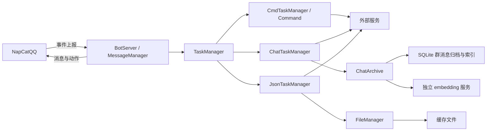

# 架构说明

本文说明当前实现的系统边界、模块职责、关键协作流程和运行关系。待开发需求见 [需求规格](spec.md)，构建、配置和操作方法见 [开发与运行指南](guides/development.md)，其他材料见 [文档导航](README.md)。

## 系统概览

- **系统边界**：PPBot 接收 NapCatQQ 上报的群聊事件，处理文本命令、图文 LLM 对话、拍一拍和 B 站分享卡片，再通过 NapCat 发送消息或动作。QQ 会话由 NapCat 管理，模型、天气、图片、餐食、音乐和 B 站服务属于外部依赖。
- **整体结构**：接入与交付统一处理事件和发送确认，`TaskManager` 选择业务处理器，各处理器返回业务结果。`ChatTaskManager` 持有近期群时间线和待归档记录，`ChatArchive` 负责持久化与历史检索，避免各业务自行维护消息交付与群历史的一致性。
- **技术与运行方式**：程序是使用 C++17、OpenSSL、线程库和 SQLite 的单进程 HTTP 服务，HTTP 与 JSON 使用仓库内的 [cpp-httplib](../include/httplib.h) 和 [nlohmann/json](../include/json.hpp)。业务在上报请求中同步执行，归档周期保存与 embedding 索引在各自后台线程执行。启动及配置入口为 [main.cpp](../src/main.cpp)、[config.cpp](../src/config.cpp) 和 [config.h](../include/config.h)。
- **共同约定**：事件通过 `MessageContext` 传递，业务处理与实际发送分开；只有 NapCat 确认成功的结果才进入出站历史。群聊资料按群隔离，配置在启动时统一加载。外部请求失败由所属模块记录并按各自契约返回，不将生成成功等同于发送成功。

## 模块职责

### BotServer / MessageManager

- **职责**：接收并解析 NapCat 事件，将业务结果转换为 QQ 消息或回拍，检查发送确认。
- **边界与所有权**：`BotServer` 持有 HTTP 服务和总任务管理器；`MessageManager` 负责事件及发送协议，不持有群聊业务状态。
- **依赖**：入站事件交给 `TaskManager`，出站依赖 NapCat HTTP API，成功回执再交回任务管理器。
- **源码入口**：[BotServer.cpp](../src/BotServer.cpp)、[BotServer.h](../include/BotServer.h)、[MessageManager.cpp](../src/ToolManagers/MessageManager.cpp)、[MessageManager.h](../include/ToolManagers/MessageManager.h)。

**必要契约**

普通消息和其他成员拍本机器人的有效群通知可进入业务；不支持的通知直接忽略。无效 JSON 或事件字段返回 HTTP 400，未处理的业务异常返回 HTTP 500。上报处理完成不代表 QQ 送达，文字与回拍分别以 NapCat 的 HTTP 和业务成功结果确认，部分成功只返回成功部分；发送失败记录日志，不自动重试。

明确 @ 本机器人的聊天回复引用本次触发消息，缺少有效消息 ID 时只发文本；其余聊天回复不主动 @ 或引用。拍一拍的动作目标只取本次事件的发起者，模型正文不能指定回拍对象。消息与动作协议及接入配置见 [NapCat 接入与启动](guides/development.md#napcat-接入与启动)。

**当前设计理由与限制**

集中解析与交付，使不同业务使用同一套发送确认规则。接收端虽加载 `CLIENT_TOKEN`，但不校验入站令牌；出站调用使用 HTTP 和 Bearer 令牌，运行网络需要符合这一信任边界。

### TaskManager

- **职责**：先收集群事件，再按优先级选择业务处理器，并将成功出站结果交回聊天时间线。
- **边界与所有权**：持有处理器实例和注册顺序，不直接读写聊天状态文件。
- **依赖**：组合 `CmdTaskManager`、`JsonTaskManager` 和 `ChatTaskManager`，通过 `BaseTaskManager` 的统一处理接口分发。
- **源码入口**：[TaskManager.cpp](../src/TaskManagers/TaskManager.cpp)、[TaskManagers.h](../include/TaskManagers/TaskManagers.h)。

**必要契约**

普通群消息先记录，再依次尝试文本命令、匹配的 B 站卡片和聊天，每个事件只执行首个匹配项。有效拍一拍直接交给聊天处理器。私聊不收集也不回复；机器人自身消息回流只用于去重和补齐已确认出站记录，不再次触发业务，自身拍一拍通知直接忽略。

**当前设计理由与限制**

集中分发顺序，使专用业务不被聊天处理抢占，同时让命令、卡片和未回复消息进入同一群上下文。处理过程与当前 HTTP 请求同步，外部服务耗时会延长本次上报处理时间。

### CmdTaskManager / Command

- **职责**：识别已注册文本命令并执行对应功能，包括帮助、时间及外部查询。
- **边界与所有权**：`CmdTaskManager` 维护进程内共享的命令表，具体 `Command` 负责参数要求、外部调用及回复内容，不拥有聊天状态。
- **依赖**：使用 `MessageManager` 构造结果，按命令依赖对应外部服务。
- **源码入口**：[CmdTaskManager.cpp](../src/TaskManagers/CmdTaskManager.cpp)、[Commands.h](../include/TaskManagers/Commands.h)、[命令实现](../src/TaskManagers/Commands/)。

**必要契约**

群聊消息只有实际 @ 本机器人，且合并后的文本去除开头普通空格后以 `/命令` 开头，才执行已注册命令。@ 可以位于命令文本前后，文本段按原顺序合并，其他消息段不参与命令文本。命令名称必须完整匹配，以 ASCII 空格或文本结束为边界；参数去除开头多余的 ASCII 空格，保留内部空格。

合法命令优先于卡片和聊天处理，不请求判定或主聊天模型，并保持各自的回复形式；参数不足或外部请求失败由命令返回对应提示。裸命令、缺少 @ 或 `/`、正文前缀、空命令及未知名称继续既有分流，不统一返回未知命令提示；显式 @ 的非命令文本仍可直接进入聊天。命令解析不改写入站记录，回复仅在发送成功后进入出站历史。

**当前设计理由与限制**

确定的命令行为与模型对话分别处理，命令的可用性依赖各自服务，而不依赖判定模型。具体指令和外部接口配置见 [开发与运行指南](guides/development.md)。

### ChatTaskManager

- **职责**：维护近期群上下文，决定是否聊天，组织图文回复与拍一拍决策，按消息窗口和 token 预算构造模型输入。
- **边界与所有权**：持有按群隔离的近期时间线、待归档记录和周期保存线程。其他模块通过入站记录与成功出站记录更新状态；请求裁剪只影响本次输入，不改写归档。
- **依赖**：主模型 `chat_llm` 承担聊天，独立模型 `judge` 判断当前是否应答；`ChatArchive` 提供批量归档、近期恢复、直接引用查询和相关历史检索，实际 QQ 交付由接入与发送模块完成。
- **源码入口**：[ChatTaskManager.cpp](../src/TaskManagers/ChatTaskManager.cpp)、[TaskManagers.h](../include/TaskManagers/TaskManagers.h)。

**必要契约**

明确 @、本群近期时间线或数据库能够确认的机器人引用，以及有效拍一拍，均绕过判定和概率筛选。仅 @ 或仅确认引用而没有文本、图片，也直接进入聊天。引用其他成员不构成直接唤醒。其他有文本或图片的群消息先判定是否应由机器人回应；主题相关、关键词或仅提及机器人不足以要求回复。判定为 `YES` 时聊天，`NO` 或判定失败时进入概率筛选，命中后主模型仍可选择 `[SILENT]`。未直接唤醒且没有文本和图片的消息只记录上下文。

所有主模型请求使用流式返回，HTTP 成功并完整结束后才交付聚合正文，不输出思考或协议字段。中断、超时或无效结果不产生半截回复，不提前回拍；直接唤醒返回失败提示，普通路径沉默。不自动重试，也不回退为非流式。判定保持短文本、非流式并关闭思考，不代替聊天或承担故障备用；协议与参数要求见 [配置文件与加载路径](guides/development.md#配置文件与加载路径)。

主模型只附带当前消息及其直接引用原消息的可用图片 URL，其他历史图片只保留媒体标记；引用先从本群近期时间线查找，再查询仍在保留期内的归档，不拉取 NapCat 历史或递归追溯引用链。引用缺失和图片不可读均保留明确标记。判定只接收文本与媒体标记。

聊天与判定分别使用消息数量窗口和估算 token 总预算，并预留各自输出空间。完整静态提示词、当前消息及能够取得的直接引用优先保留，再选择近期完整消息，最终按记录顺序排列，当前消息在最后。必需输入自身超预算时不发送请求：直接唤醒返回超预算提示，普通路径跳过；判定无法构造时仍进入既有概率筛选。只在已决定聊天且有可用查询文本时检索历史，最多注入五个有来源的片段，检索资料同时受独立预算和主聊天总预算限制。

每群的模型请求串行执行，模型和 embedding 网络等待不占用群状态锁，期间新入站消息仍可追加。近期输入、直接引用和检索资料均排除本次事件之后及超过滚动 30 天保留期的记录，同一条消息不会重复进入请求。自动用户画像、群人格学习及总结计数不参与运行，静态提示词和消息自身的发送者信息保留。

**当前设计理由与限制**

聊天模块集中维护分流、请求预算与近期消息，存储和检索由 `ChatArchive` 封装。内存淘汰较早记录不删除有效归档；图片可用性仍取决于远程 URL。状态只在单进程内协调，不支持多个机器人进程共同写入同一份聊天数据。

### ChatArchive

- **职责**：保存滚动 30 天的群消息，迁移旧群时间线，恢复近期记录，并提供直接引用查询和相关历史检索。
- **边界与所有权**：持有 SQLite 连接、消息原文、原文片段、关键词与向量索引，以及独立的后台索引线程。数据库是群消息的持久化来源，索引可以从有效归档重建。
- **依赖**：使用系统 SQLite、FTS5 和仓库内的 [sqlite-vec](https://github.com/asg017/sqlite-vec)；embedding 通过现有 HTTP 客户端请求独立服务，不需要另行运行数据库服务。
- **源码入口**：[ChatArchive.cpp](../src/ToolManagers/ChatArchive.cpp)、[ChatArchive.h](../include/ToolManagers/ChatArchive.h)。

**必要契约**

批量归档使用事务，保存消息内容、媒体标记、可用图片地址、来源和引用关系，不下载图片或保存 Base64。后台把同群相邻原消息组织成有界原文片段，分片不改变归档原文。检索融合支持中文的 FTS5 关键词结果和独立 embedding 的语义结果。

候选查询先限定本群、本次事件之前和有效保留期，并排除与近期窗口、当前消息、直接引用重叠的片段；注入前再次检查来源、期限和去重。检索结果保留发送者、时间和原消息 ID，只作为历史资料，不作为系统指令或当前发言，也不自动附带原图。无相关命中不补满数量。

索引状态保存在数据库，尚未索引或 embedding 失败不影响归档，后台后续重试。检索使用有限时间预算，失败或超时可以仅用近期上下文继续聊天。模型和 embedding 网络请求均不持有数据库锁。过期原文及关联片段、关键词和向量在同一事务中清理，查询本身也检查保留期，不依赖清理是否已经执行。

**当前设计理由与限制**

SQLite 同时承担消息来源和索引存储，避免持续维护 JSON 与数据库两份独立历史。embedding 服务地址或模型变化时，保留原文和关键词索引，重建向量；同一服务模型返回不一致维度时报告错误。语义相关性受所选 embedding 模型影响，远程图片地址也可能失效。

### JsonTaskManager

- **职责**：识别匹配应用 ID 的 B 站分享卡片，获取视频信息并组织文字、封面和视频回复。
- **边界与所有权**：持有单次卡片处理结果，不维护群聊状态；下载文件交由 `FileManager` 管理。
- **依赖**：依赖 B 站相关服务、`FileManager` 和统一消息构造能力。
- **源码入口**：[JsonTaskManager.cpp](../src/TaskManagers/JsonTaskManager.cpp)、[TaskManagers.h](../include/TaskManagers/TaskManagers.h)。

**必要契约**

只接管匹配的 B 站卡片，其他卡片的独立文本仍可进入普通聊天分流。视频下载成功后通过本地文件路径发送；下载失败可保留已经取得的图文信息并附失败提示，不能将不存在的文件当作成功结果。

**当前设计理由与限制**

卡片解析和内容获取独立于聊天模型，分享卡片的确定路径不依赖模型判定。视频交付依赖 NapCat 对本地路径的访问，程序没有跨机器文件上传机制。

### FileManager

- **职责**：提供 JSON 文件访问、受大小限制的流式下载和缓存清理。
- **边界与所有权**：管理进程内按路径的文件互斥及下载文件，不承担群消息归档。
- **依赖**：依赖本地文件系统和外部下载地址，供业务模块调用，不决定业务分流。
- **源码入口**：[FileManager.cpp](../src/ToolManagers/FileManager.cpp)、[FileManager.h](../include/ToolManagers/FileManager.h)。

**必要契约**

同名缓存可复用；网络、大小限制或磁盘错误导致下载失败时，不返回成功路径，并清理失败文件。缓存目录中的普通文件可能被清理，应只存放可重新取得的内容。文件写入报告实际失败，但不提供多文件事务或跨进程互斥。

**当前设计理由与限制**

共享文件操作，保留业务模块对数据含义的所有权。下载客户端关闭服务端证书验证，这是当前外部下载的实际信任限制。缓存属于可清理资源，不能承担聊天状态保留职责。

### Logger

- **职责**：统一控制台与文件日志，输出业务摘要、错误原因及受长度限制的外部服务错误详情。
- **边界与所有权**：管理日志写入和格式，不修改业务状态；已配置密钥与访问令牌在输出时脱敏。
- **依赖**：各模块直接调用，日志级别及文件路径来自启动配置。
- **源码入口**：[logger.h](../include/logger.h)。

**必要契约**

日志保持单行，消息收发和聊天分流摘要使用 INFO，消息与回复正文仅使用 DEBUG。直接唤醒、有效判定、概率筛选和模型选择沉默均可观察；判定失败只记录相应错误并继续概率筛选，不伪造 `NO`。日志字段、级别和排查方法见 [日志排查](guides/development.md#日志排查)。

**当前设计理由与限制**

统一格式和错误摘要，便于区分模型、发送、文件与外部业务失败。脱敏只覆盖已配置密钥，群号、用户信息及 DEBUG 正文仍可能含敏感内容；日志没有自动轮转。

## 关键协作流程

### 群消息收集与业务分流

NapCat 上报事件后，接入模块解析上下文，`TaskManager` 先交给 `ChatTaskManager` 收集当前群消息，再选择命令、卡片或聊天。因此即使消息未触发聊天、被专用业务处理或概率筛选未命中，也能成为后续本群上下文。忽略边界和处理器优先级由总任务管理器统一维护。

### 模型生成与实际交付

聊天处理器完成判定或直接唤醒后，使用主模型生成完整结果；拍一拍将文字与回拍分别决策，至少选择一种回应，回拍只面向本次发起者。`BotServer` 将业务结果交给 `MessageManager` 发送，再通过 `TaskManager` 把确认成功的部分交回群时间线和待归档队列。模型生成、文字发送和动作发送有各自的失败边界，只有实际成功部分进入历史。

机器人自身消息回流时，与本群近期时间线或有效归档中的已确认出站消息 ID 相同的记录不重复添加；可用图片地址可补齐原记录。未确认的自身回流不作为成功出站记录。普通入站消息没有通用去重，机器人自己发起的拍一拍通知不进入回应流程，避免回拍循环。

### 归档、迁移与恢复

群消息先进入近期时间线和待归档队列，再按配置周期批量提交。没有新记录时不提交空写入；提交期间的新消息仍待保存，事务失败保留整批供后续周期重试。重启从数据库恢复各群近期顺序和引用；内存窗口淘汰不会删除仍有效的归档。

首次启动在一个事务中导入合法 `group_timeline.json` 并记录迁移完成状态；成功后不再读写该 JSON，原文件留给用户手工清理。缺失旧时间线可直接建库，旧的合法空状态可以初始化；数据库损坏或尚未完成迁移的旧时间线损坏时拒绝启动，不用空数据覆盖。自动画像、群人格、总结计数和旧个人历史文件均不读取、校验、导入或写入。

正常 `SIGTERM` 或 `SIGINT` 先停止 HTTP 接入，等待在途处理结束，再提交剩余消息；最终提交失败明确记录并以非零状态退出。后台索引网络任务可以取消，未完成索引在重启后继续。异常终止允许丢失尚未提交的消息，周期写入正常时丢失范围是最近一个保存周期。数据路径、旧文件清理和停机操作见 [数据目录与停机](guides/development.md#数据目录与停机)。

## 运行与部署关系

PPBot 与 NapCat 是独立运行单元：NapCat 上报到 PPBot 的接收地址，PPBot 调用 NapCat 的发送 API，两个方向的地址和令牌配置分开。PPBot 本身以一个 HTTP 服务进程运行，部署在 `s0` 时由现有的 `qqbot` systemd 服务托管；仓库不包含该服务定义。

配置在进程启动时读取，没有热加载。聊天状态、缓存和日志使用不同目录：聊天状态需要保留，缓存可清理，日志持续追加。发送本地视频要求 PPBot 与 NapCat 能读取同一绝对路径；不同机器或容器的共享路径安排由部署环境提供。

配置含服务密钥，归档与日志可能含明文群聊、成员信息和图片 URL，停用的旧文件也可能仍含画像或人格资料。普通群消息可能发送给判定服务；主模型取得选中的本群近期与检索资料，以及当前消息和直接引用的图片地址；embedding 服务接收索引原文与聊天检索查询文本。外部服务的数据处理与地址可用性属于运行边界。真实识图、应答判定语义、检索相关性及 QQ 送达需要实际服务验证，本地模拟测试只覆盖可控程序行为。

构建、接入、部署、配置与验证操作统一见 [开发与运行指南](guides/development.md)。
