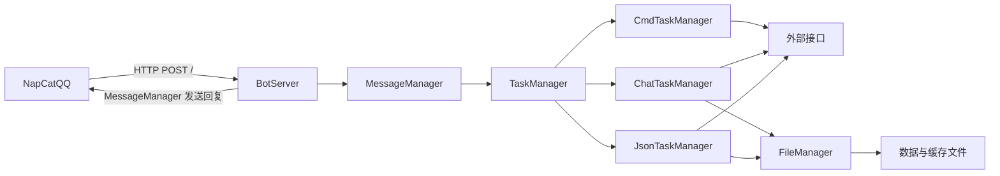

# 架构说明

本文描述当前源码的模块、共享群时间线、回复分流与持久化边界。待开发需求及其验收要求见 [需求规格](spec.md)，构建与运行方法见 [开发与运行指南](guides/development.md)。

## 系统边界与运行结构

PPBot 是一个 C++17 HTTP 服务进程。NapCatQQ 负责 QQ 会话，将消息事件上报给 PPBot；PPBot 完成命令分发、AI 请求或分享卡片处理，再调用 NapCat API 发出回复。天气、图片、餐食、音乐、AI 和 B 站服务均是外部依赖。

`TaskManager` 先将群消息交给 `ChatTaskManager` 记录，再按命令、匹配的 B 站卡片、AI 的顺序分发，每次事件只执行首个匹配项。符合条件的拍一拍通知直接交给聊天处理器。主聊天模型负责图文回复、回拍决策及人格、画像总结，独立判定模型只决定是否明确需要回应。

## 模块职责与源码入口

| 模块 | 职责与状态归属 | 源码入口 |
| --- | --- | --- |
| 启动与配置 | 加载 JSON 到全局配置变量，创建服务并开始监听 | [main.cpp](../src/main.cpp)、[config.cpp](../src/config.cpp)、[config.h](../include/config.h) |
| `BotServer` | 持有 HTTP 服务和总任务管理器，注册 `POST /`，处理上报并发出回复 | [BotServer.cpp](../src/BotServer.cpp)、[BotServer.h](../include/BotServer.h) |
| `MessageManager` | 解析消息、拍一拍及身份信息，构造消息段，调用 NapCat 并返回确认成功的文字或动作回执 | [MessageManager.cpp](../src/ToolManagers/MessageManager.cpp)、[MessageManager.h](../include/ToolManagers/MessageManager.h) |
| `TaskManager` | 收集群消息和有效拍一拍，分发业务，并将成功发送的回复及回拍交回群时间线 | [TaskManager.cpp](../src/TaskManagers/TaskManager.cpp)、[TaskManagers.h](../include/TaskManagers/TaskManagers.h) |
| `CmdTaskManager` | 维护静态命令表，识别名称和参数，执行对应 `Command` | [CmdTaskManager.cpp](../src/TaskManagers/CmdTaskManager.cpp)、[Commands.h](../include/TaskManagers/Commands.h)、[命令实现](../src/TaskManagers/Commands/) |
| `ChatTaskManager` | 持有群时间线、群人格、成员画像和计数，组织判定、概率筛选、聊天、总结与定时保存 | [ChatTaskManager.cpp](../src/TaskManagers/ChatTaskManager.cpp) |
| `JsonTaskManager` | 识别 B 站分享卡片，查询元数据和播放地址，组织视频下载和回复 | [JsonTaskManager.cpp](../src/TaskManagers/JsonTaskManager.cpp) |
| `FileManager` | 提供进程内按路径加锁的文件读写、缓存下载和清理 | [FileManager.cpp](../src/ToolManagers/FileManager.cpp)、[FileManager.h](../include/ToolManagers/FileManager.h) |
| `Logger` | 按级别输出控制台和文件日志，统一单行格式、密钥脱敏与 HTTP 错误摘要 | [logger.h](../include/logger.h) |

`BaseTaskManager` 用 `canHandle` 和 `handleTask` 统一分发接口；处理结果由消息段 JSON 和发送方式组成。`Command` 统一命令名、执行结果和发送方式。新增业务需接入相应注册点，单独添加类不会自动成为可触发功能。

HTTP 和 JSON 分别使用仓库内的 [cpp-httplib](../include/httplib.h) 和 [nlohmann/json](../include/json.hpp) 头文件；构建还依赖 OpenSSL 和线程库。

## 消息处理契约

`BotServer::handlePost` 先解析请求体。非法 JSON 或已接收事件的字段转换失败返回 HTTP 400；只接收普通消息和目标为本机器人的有效群拍一拍，其他事件直接返回 `{}`。消息事件需要 `message_type`、整数或字符串形式的 `user_id`、群聊的 `group_id` 和数组格式 `message`。拍一拍需要 `notice/notify/poke` 事件类型、有效群号及发起者，目标必须是配置的机器人 QQ，发起者不能是机器人自身。业务处理中未被处理器捕获的异常会记录群号、消息 ID 和原因，并返回 HTTP 500。

`MessageContext` 保存群号、发言人、显示名、消息 ID、时间、引用 ID、原始消息段及解析结果，拍一拍另带事件标志和目标。文本段顺序拼接并去除前导 ASCII 空格；整数或字符串形式的 `at.qq` 只有与配置的机器人 QQ 相等才算 @ 本机器人。图片通过消息段中的 HTTP(S) URL 进入主聊天模型；语音、视频和卡片只保留类型及可用文本。

所有群消息先进入本群时间线，包括命令、卡片、普通未回复消息和机器人自身消息。有效群拍一拍先记录再调用主模型；拍其他成员、自身发起、私聊拍一拍及其他通知不收集也不回复。私聊消息不进入群时间线，也不产生业务回复；机器人自身消息记录后不再分发。文本命令无需 @，优先于卡片及 AI；只有应用 ID 匹配的卡片由 B 站处理器接管，其他卡片中的独立文本仍可进入 AI 分流。

业务调用在当前 HTTP 请求中同步完成，没有独立任务队列。非空回复交给 `MessageManager::send_msg`：`direct` 使用群聊发送接口，其他发送方式使用合并转发接口，每个普通消息段封装为一个转发节点。视频段始终与普通消息分开，逐条发送。转发节点使用原发言者 ID 和 `Bot` 昵称。

聊天文字在明确 @ 本机器人时使用 `reply` 段引用本次触发消息，再附正文文本，不额外添加 `at`。触发消息没有有效 ID 时只发文本，不改用入站引用的旧消息 ID。输入提示和聊天失败提示使用同一规则。其余聊天回复仅发文本，包括无 @ 地引用机器人、判定通过、概率插话和拍一拍的文字回应。命令和 B 站卡片沿用各自的输出方式。

拍一拍请求要求主模型把文字正文和回拍布尔决策分开返回，至少选择一种回应。程序只解析该类请求的结构化决策，正文不解释为接口指令。发送层将内部动作与消息段分离，调用 NapCat 的 `/group_poke`；群号和目标只取本次事件的群号与发起者，不能由模型指定其他对象。

出站 NapCat 请求使用 HTTP 和 Bearer 令牌。只有 HTTP 200、业务 `status` 为 `ok` 且 `retcode` 为 0 的消息或动作才返回成功回执，由 `BotServer` 交回群时间线；文字与回拍、多个消息组分别确认，部分成功时只记录成功部分。发送失败只记录日志，不重试。机器人回流消息与本群已有出站消息 ID 相同时不重复记录；回流中可用的图片 URL 按图片顺序补齐原记录缺失或无效的地址，保留已有可用 URL，不新增时间线记录或重复计数。普通入站事件没有通用去重，自身拍一拍通知直接忽略。处理完成后的 `{}` 不是 QQ 送达确认。接收端虽加载 `CLIENT_TOKEN`，但未检查请求令牌。

## AI 状态与请求路径

### 状态归属

`ChatTaskManager` 实例持有群时间线、人格、成员画像、计数及保存线程。状态更新和保存快照使用同一互斥锁，网络请求不持有该锁；每群另有请求锁，串行执行该群的判定、聊天和总结。模型生成期间仍可追加新入站消息，完成回复时只追加成功发送记录，不用旧快照覆盖时间线。进程之间没有状态协调。

时间线以完整群号为键，记录带有接收序列、事件类型、发起者身份、时间、文本、@、引用和媒体消息段。拍一拍使用 `event_type="poke"` 和 `target_id` 区分于普通发言，消息 ID 与正文为空；成功回拍独立记录机器人、目标及动作发生时间。人格以群号为键，画像在群内再以成员 ID 为键；会话计数继续使用 `group_<group_id>_user_<user_id>`。保存和模型输入均受消息窗口限制，不是无限历史归档。引用直接唤醒仅在本群保留的时间线能确认被引用消息来自机器人时成立。

### 判定、聊天与总结

@ 本机器人或确认引用机器人且有文本或图片时，直接调用主模型，不依赖判定服务或插话概率；直接唤醒但没有文本和图片时返回输入提示。有效拍一拍同样绕过判定和概率，必须选择文字、回拍或两者，模型请求失败或决策无效时返回失败提示。其余有文本或图片的消息先调用 `judge`，只接受 `YES`、`NO`。`YES` 进入聊天；`NO`、超时、网络错误或无效结果进入同一本地概率筛选，判定不重试。概率默认 10%，可通过 `ai.reply_probability` 调整；未命中则沉默，命中后聊天模型仍可用 `[SILENT]` 选择沉默。未直接唤醒且没有文本和图片的语音等消息只进入时间线。

`ai` 是唯一聊天模型，也负责群人格和成员画像总结；`judge` 不承担聊天或故障备用。以 `/` 开头的文本保留原文，遵循相同分流，没有 `ai2` 或单次图文入口。聊天输入包含机器人身份、配置人设、本群人格、相关成员画像及较长的群历史；判定复用同一人设和群历史的短窗口，不带长期成员画像。固定模型职责与群聊资料分开提供，当前消息只出现一次。

聊天请求中，带可用图片的每条记录由文本元数据和 `image_url` 内容组成，元数据保留发言人、消息及图片顺序，使多图与来源对应。无图记录继续使用文本内容，判定与总结请求也只使用文本和媒体类型标记。图片 URL 缺失或不是 HTTP(S) 时保留不可读取标记，不下载图片、不转 Base64，也不探测地址或重试。远程地址失效或服务拒绝图片导致的请求失败沿用聊天失败处理：直接唤醒返回失败提示，普通路径沉默。

两个模型分别配置时间线消息窗口、超时、输出限制和字节预算。固定职责和背景额外占两条 API 消息，也包含在预算中。输入以完整序列化 `messages` 的 UTF-8 字节数计量，并从 `context_bytes` 先预留 `4 * max_tokens` 字节给输出；图片 URL 计入字节数，但这不能衡量视觉 token 或费用。超限先整条移除最早历史及其图片，再缩减背景及超长当前文本，UTF-8 截断保留字符边界。当前消息的有效图片和完整 URL 不被丢弃或截短；若仍无法满足预算则不发出模型请求。

每组成功发送的消息及每次成功回拍分别累计成员及群计数。下一次进入聊天模型路径时，计数达到 `max(1, ai.max_rounds / 10)` 就同步调用主模型总结。群人格只使用本群时间线，成员画像只使用该成员本人的群记录和已有画像；名字来自入站消息，不另向 NapCat 查询成员，缺少昵称和名片的拍一拍不会清空已有名片。只有有效非空总结才替换旧值并扣除已总结计数，失败保留原数据和计数。总结使用主模型的同一窗口及预算，会增加当前聊天请求耗时。

### 持久化与退出

启动自动创建 `DATA_PATH/AiModule/`，加载群时间线及原有的成员计数、群计数、群人格、成员画像。时间线保存在 `group_timeline.json`，顶层键为 `group_timeline`；缺少事件类型的旧时间线记录按普通消息读取，拍一拍与回拍保存在同一文件。原人格、画像及计数文件沿用原顶层键和群、成员键。旧 `session_memory.json` 原样保留，程序不读写，也不将缺少时间顺序的个人历史拼入新群时间线。文件含义见 [数据目录](guides/development.md#数据目录与停机)。

数据文件不存在或旧空状态为合法 JSON `null`、`{}` 时可从空状态开始；已有文件为空、JSON 损坏或非空结构不符时中止启动，避免按空状态覆盖原数据。

普通消息收集及其他状态更新都会增加版本。保存线程按 `SAVE_FREQUENCY` 周期对变化的状态取快照并覆盖五个文件，保存期间新收到的数据保留为下一版本；没有变化时不重复写入。写入会检查刷新结果，首个失败使本轮后续文件跳过，并保留待保存状态。文件直接截断写入，没有原子替换或跨文件事务。析构只停止并等待线程，不执行最后保存；入口也没有信号停机处理，不能保证退出前状态全部落盘。

## 卡片与文件路径

`JsonTaskManager` 只接受应用 ID 匹配的 B 站卡片，读取分享短链，以 HEAD 请求取得 302 的 `Location`，提取 BV 号后查询信息和播放地址。文件管理器先清理缓存，再下载视频；处理器将封面、统计文本和本地 `file://` 视频路径交给发送层。下载失败时附加文本提示。

天气、图片、餐食、音乐和 B 站处理器分别检查网络、HTTP、接口业务及响应字段错误，返回相应失败提示。HTTP 和业务失败使用 `Logger::httpError` 记录操作、HTTP 状态及服务可提供的错误原因；错误体不是 JSON 时保留有长度限制的文本摘要，不再为打印错误体进行会抛异常的 JSON 解析。歌曲搜索未得到 ID、卡片未得到 BV 号或图片地址为空时，不发起依赖该结果的后续请求或发送无效媒体。

文件下载按保存路径使用进程内互斥锁，已存在的同名文件直接复用；流式写入受单次下载大小限制，网络失败、HTTP 异常或超限时删除失败文件。下载跟随重定向，设置 60 秒读写超时，并关闭服务器证书校验。短链和下载路径使用的客户端为 SSL 客户端，URL 中显式端口未被采用，不能将其视为通用 URL 下载接口。

缓存清理仅在 B 站下载前触发。缓存目录中的普通文件超过数量配置时，按大小从大到小、同大小按修改时间从旧到新删除至配置数量，随后下载可能再增加一个文件。这不是磁盘容量限制或始终成立的文件数量上限，目录中其他普通文件也会参与清理。

## 日志与失败边界

`Logger` 将 JSON 紧凑输出、转义控制字符，并在控制台与文件中使用相同的单行内容，控制台另有级别颜色。HTTP 错误在一条 WARN 中记录操作、状态、原因及服务错误摘要，详细摘要最多 1536 个 UTF-8 字节。判定、聊天、人格总结及画像总结使用不同操作名；判定失败的同一条日志说明进入概率筛选，不重复报告标签无效。正常沉默不产生错误日志。

INFO 记录接收消息的群号、发言人、消息 ID、类型及发送成功摘要；消息和回复正文只在 DEBUG 输出，不为空回复打印 `null`。文件错误包含路径及可用的系统或 JSON 原因，下载失败区分网络、HTTP、超限与磁盘错误。配置打开、JSON 格式或监听等启动失败由入口记录后以状态码 1 退出；日志文件无法写入时，错误仍输出到标准错误。

已配置的聊天、判定、高德密钥及 NapCat 双向令牌值会替换为脱敏标记，但日志摘要仍含群号、用户号等信息，DEBUG 和数据文件仍可能包含明文消息；这不是对所有敏感内容的自动清洗。日志级别及排查示例见 [运行指南](guides/development.md#日志排查)。

## 部署与数据边界

PPBot 和 NapCat 是两个运行单元，HTTP 上报方向与 API 调用方向相反。发送本地视频要求 NapCat 可读取 PPBot 使用的同一绝对缓存路径，跨机器部署没有文件上传机制。程序只提供前台服务入口，仓库没有服务托管配置。

配置一次加载为全局变量，没有热加载。缓存属于可再获取的数据，AI 状态需要保留，日志持续追加且没有轮转。配置存放服务密钥，数据及日志包含明文消息、画像、人格和图片 URL。普通未 @ 的文本或图片消息也可能发送给判定服务，但判定不接收图片 URL 或图片内容；主 AI 请求携带裁剪后的本群历史、相关画像及图片 URL，模型服务可获取对应图片。URL 可能失效，保存或重启不能保证图片仍可读取。运行路径与配置字段的实际使用方式见 [开发与运行指南](guides/development.md)。
